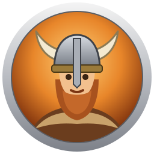
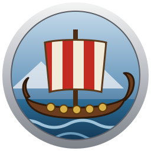
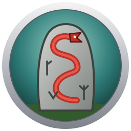

<p align="center">
  
  
  
  
  
</p>

# CulturesRecomp

## 👉 [**Open the converter: gamerecomp.github.io/CulturesRecomp**](https://gamerecomp.github.io/CulturesRecomp/) 👈

**Turn your own copy of a Cultures game (the GOG installer, or a zip of the installed Saga) into a native build
for Windows, Linux or Android, or play it right in your browser.** Everything happens in the browser tab: your
installer is not uploaded anywhere.

CulturesRecomp is an unofficial project that rebuilds the *Cultures* games by Funatics as native programs for
today's systems, from your own copy: no emulator, no Wine, no DOSBox. The game's own code is translated ahead of
time ("static recompilation") and runs on a small replacement for the parts of Windows and DirectX it uses.

> Unofficial fan project. Not affiliated with Funatics, THQ Nordic, JoWooD or GOG.
> This repository contains **no game code and no game data**, and it never will: you bring the game.

## The games

| | Game | What you need |
|-|------|---------------|
|  | **Cultures: Discovery of Vinland** (Die Entdeckung Vinlands) | the GOG installer, English or German (`setup_cultures_2.1.0.12.exe`) |
|  | **Cultures 2: The Gates of Asgard** (Die Tore Asgards) | the GOG installer, English or German (`setup_cultures2_2.1.0.10.exe`) |
|  | **Cultures: Northland** (Reise nach Nordland) | the GOG installer, English, German or Spanish (`setup_northland_2.1.0.9.exe`) |
|  | **Cultures: 8th Wonder of the World** (Das Achte Weltwunder) | the GOG installer, English, German or Spanish (`setup_8th_wonder_2.1.0.9.exe`) |
|  | **Cultures – Die Saga** (German) | a zip of the folder the game was installed to from its CD (`Game.exe` and `DataX` in it) |

The German *Cultures Gold* CD (with the add-on *Die Rache des Regengottes*) works too, through the developer tools
(see [docs/DEVELOPMENT.md](docs/DEVELOPMENT.md)). Steam copies are not supported yet.

## How to play

1. Open the **[converter](https://gamerecomp.github.io/CulturesRecomp/)** and pick your game's tab.
2. Choose your installer (or the Saga zip). It stays on your computer: the page converts it in the browser tab and
   uploads nothing.
3. Choose your system:
   - **Windows**: unzip the download and start the game's `.exe` in its folder.
   - **Linux**: unzip it and start the `.AppImage`.
   - **Android**: install the `.apk` (allow apps from this source when asked).
   - **Browser**: play right there; the game is kept in the browser, so you convert it only once.

The build contains your copy of the game: keep it for yourself and do not share it.

### Without a browser

The [releases](https://github.com/GameRecomp/CulturesRecomp/releases/latest) offer the converter as a program for
Windows and Linux (`CulturesRecomp-converter-<system>-<arch>`), with everything it needs inside. It works
offline:

```sh
./recomp convert --system linux setup_cultures_2.1.0.12.exe     # → Cultures-linux.zip
recomp.exe convert --system windows setup_northland_2.1.0.9.exe  # → Northland-windows.zip
./recomp convert --system android "Cultures Saga.zip"            # → CulturesSaga-android.apk
```

## Settings

Each game writes `settings.ini` into its user folder on the first start, with comments (on Windows
`%APPDATA%\culturesrecomp\<game>\`, on Linux `~/.local/share/culturesrecomp/<game>/`). Saved games are there
too. The most useful settings:

| Setting | Values |
|---------|--------|
| `resolution` | `window x1` (the default: the size of the window, following it), `window x1.5` to `window x3` (larger interface and figures), `screen`, a size such as `1920x1080`, or `off` (the game's own) |
| `fullscreen` | `yes` or `no`; **Alt+Enter** switches while playing |
| `scale`, `pixels` | how the picture fills the window: `fit` or 1 to 4 times, `sharp` or `smooth` |
| `hardware_cursor` | `yes` (the system's mouse pointer, smooth) or `no` |
| `fps` | a frame limit, for a cooler and quieter computer |

In Cultures 1 the options pages offer the window sizes too ("Window x1" …), and a running mission follows the window
when you resize it. The other games take the window's size when they start. In the browser the player page has
the same choices.

## State

All five games run: intros, menus, campaigns, sound and music, saving and loading, LAN games, and the map editors
of Northland, 8th Wonder and the Saga. It is young software: campaigns have not yet been played through to the end
by hand, and the Windows and Android builds come straight from the build service. Known issues are listed in
[docs/RELEASE-NOTES.md](docs/RELEASE-NOTES.md); reports are welcome as
[issues](https://github.com/GameRecomp/CulturesRecomp/issues).

## For developers

How it works, how to build it from source and the project's documentation:
[**docs/DEVELOPMENT.md**](docs/DEVELOPMENT.md).

## License

[MIT](LICENSE) applies to the code in this repository. The games themselves are the property of their
rights holders. Buy them (for example on GOG) to use this project.
